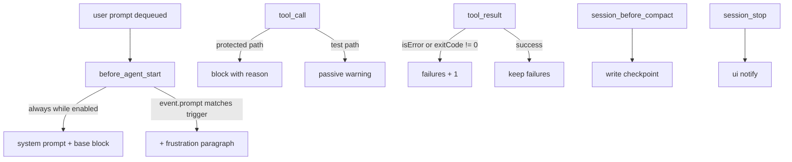

# PUA Claude-Hook Parity - Plan

## Goal Capsule

- **Objective:** an omp session running this plugin applies the same diligence pressure the Claude Code PUA plugin applies — prompt-level frustration gating, tool-failure pressure that is not reset by unrelated successes, a verifier/CI protection gate, and state that survives compaction — with all state local under `~/.pua/`.
- **Means:** map each Claude hook onto an omp extension event, keeping the Claude `hooks/*.sh` policy tables as the behavioural authority (KTD1).
- **Authority:** the Product Contract below wins on behaviour; KTDs win on mechanism; per-unit instructions override neither.
- **Execution profile:** one PR, four units, one file plus one test file.
- **Stop conditions:** the trigger cannot be evaluated from the prompt text `before_agent_start` carries; any unit needs a new omp API that does not exist.
- **Finished by:** `ce-work` implements; the caller ships.

---

## Product Contract

### Summary

Port the four highest-value Claude Code PUA hooks into the omp extension: a frustration gate on submitted prompts, pressure accounting from tool results, an integrity guard on verifier-adjacent writes, and compaction-surviving state plus a stop reminder.

### Problem Frame

The Claude Code plugin gates its context on user frustration (`hooks/frustration-trigger.sh`) and keeps a failure counter that successful tools never reset (`hooks/failure-detector.sh`). The omp port injects context unconditionally and resets the counter on any successful tool call, so pressure never accumulates and the gate never fires.

### Requirements

- R1. While PUA is enabled, every agent turn carries the base context block (flavor, pressure level, checkpoint numbers when one exists); a prompt matching the frustration trigger set adds the frustration paragraph, and a prompt that does not match adds nothing more.
- R2. A successful tool call never resets the failure pressure counter; only a failed tool call increments it.
- R3. Tool failures count when `event.isError` is true, or when the tool is `bash` and its exit code is non-zero.
- R4. While PUA is enabled, a write to a verifier-adjacent path is refused with a stated reason; a write to a test path is allowed but adds a passive warning.
- R5. Before compaction, the extension writes a scoped checkpoint (level, failures, flavor, timestamp) and writes none while PUA is disabled.
- R6. The system prompt carries the flavor line and the numeric pressure state on the first turn of a session and on the first turn after compaction, reading the checkpoint when it is newer than the live counter.
- R7. On session stop the extension emits one user-visible feedback reminder and records no rating.
- R8. The extension performs no network access and writes only under `~/.pua/`.

### Scope Boundaries

- Deferred: subagent teardown accounting — omp has no subagent-stop event (only `before_subagent_spawn` and the child's own `agent_end`).
- Deferred: blocking stop loop (`pua-loop-hook.sh` gate protocol); omp's `session_stop` continuation cap of 8 makes the Claude loop semantics unavailable.
- Deferred: interactive `/pua:survey` rating flow and `feedback.jsonl` recording.
- Deferred: shell-mediated writes. A `bash` redirect into a protected path is not intercepted; the guard inspects tools that name a file, while the Claude guard also parses shell commands. Porting that heuristic is deferred until a run shows a protected file reached through the shell.
- Considered and not built: hard-blocking test-file writes. omp implementation runs (including this repository's own `ce-work` runs) author tests, so a hard block makes the plugin unusable; an advisory warning covers the observed risk without the harm. Evidence that would change this: a run where the model weakened an existing assertion after the warning.

---

## Planning Contract

### Key Technical Decisions

- KTD1. Port the Claude hook policy as data, not as behaviour re-invented. The protected-write and contamination pattern tables in `hooks/integrity-guard.sh` and the trigger regex in `hooks/frustration-trigger.sh` are copied as regex sources so the two plugins cannot drift on what counts as a protected path. The script's secret-read table is not ported: this extension inspects write tools only, and the write table already covers secret and environment paths. (session-settled: user-directed — chosen over hand-writing fresh heuristics: the request is parity with the Claude version, and its tables are the only authority available.)
- KTD2. Gate the prompt block by matching `before_agent_start`'s own `prompt` field, not by an `input` handler and not by editing the user's text. That event fires when a batch is dequeued, so one event both decides and injects; `input` runs at submission ingress before queue insertion, so a flag set there races a second queued prompt.
- KTD3. Advisory, not blocking, for test-path writes; blocking for CI config, verifier/grader/scoring assets, hidden-solution artifacts, secret/credential paths, and status/progress files. Rationale in Scope Boundaries.
- KTD4. Checkpoint is written in `session_before_compact` and read in `before_agent_start`, not `session_start`: `session_start` fires before the checkpoint exists on a fresh session and `before_agent_start` is where the prompt is assembled on every turn.
- KTD5. All new behaviour is gated on the existing `always_on` config key; a disabled plugin registers its commands but injects, guards, and checkpoints nothing.

### Assumptions

- `before_agent_start`'s `prompt` is the already-transformed text of the selected user messages, so the trigger matches expanded text, not the raw typed string. Accepted.
- `event.details.exitCode` is present for bash tool results; when absent, only `isError` decides.

### High-Level Technical Design

### Sequencing

U1 and U2 are independent of U3 and U4. U4 reads the counter U2 writes; land U2 first when splitting.

---

## Implementation Units

### U1. Frustration gate on submitted prompts

- **Goal:** the base context block is injected on every enabled turn, with the frustration paragraph added only when the user's prompt signals frustration.
- **Requirements:** R1, R8, KTD2, KTD5.
- **Dependencies:** none.
- **Files:** `extensions/pua/index.ts`, `tests/pua-extension.test.ts`
- **Approach:**
  1. Compile a trigger set from the regex in `hooks/frustration-trigger.sh` and match it against the event's `prompt` text.
  2. In `before_agent_start`, return `undefined` for `reason: "revive"` or when PUA is disabled.
  3. Otherwise append the base block (existing `behaviorPrompt`) to the host's array, plus the frustration paragraph when the prompt matched.
- **Patterns to follow:** the existing `before_agent_start` array-preserving override in the same file.
- **Test scenarios:**
  - A prompt containing `try harder` yields an added block that contains the frustration paragraph.
  - A prompt with ordinary text yields the base block only: it contains no frustration paragraph.
  - A Chinese trigger (`又错了`) matches, proving the CJK alternation survives encoding.
  - `always_on: false` suppresses the override entirely.
  - `reason: "revive"` returns `undefined` even when the prompt matches.
- **Verification:** `bun test` covers the above by driving the factory with a stub `pi`; a manual `omp -e extensions/pua/index.ts` run confirms the command still registers.

### U2. Pressure accounting parity

- **Goal:** pressure accumulates across failures and is not erased by unrelated successes.
- **Requirements:** R2, R3, R8.
- **Dependencies:** none.
- **Files:** `extensions/pua/index.ts`, `tests/pua-extension.test.ts`
- **Approach:** replace the ternary that resets to `0` with increment-only accounting; treat `bash` `details.exitCode !== 0` as a failure alongside `isError`; persist the counter on every change.
- **Patterns to follow:** existing `readFailureCount` / `writeFailureCount` helpers.
- **Test scenarios:**
  - Two consecutive failed results raise the counter to 2.
  - A successful result between failures leaves the counter unchanged.
  - A `bash` result with `isError: false` and `details.exitCode: 1` increments the counter.
  - A `bash` result with `exitCode: 0` does not increment.
  - `always_on: false` leaves the counter file untouched.
- **Verification:** `bun test`; counter file content asserted via the temp `HOME`.

### U3. Integrity guard on verifier-adjacent writes

- **Goal:** the agent cannot rewrite the thing that scores it.
- **Requirements:** R4, KTD3, KTD5.
- **Dependencies:** none — it shares the config read and enabled gate with U1 but needs no ordering.
- **Files:** `extensions/pua/index.ts`, `tests/pua-extension.test.ts`
- **Approach:**
  1. Register `tool_call`; collect every target path the input names: `path` / `file_path` for `edit` and `write`, the `*** Add File` / `*** Update File` / `*** Move to` headers inside an edit tool's patch payload, and `path` / `paths` for `ast_edit`.
  2. Match each collected path against the ported protected-write and contamination tables.
  3. Return `{ block: true, reason }` for CI, verifier, contamination, secret, and status/progress matches; return `{ additionalContext }` for test-path matches.
  - Keep the pattern sources byte-identical to `hooks/integrity-guard.sh` so a later diff against upstream is mechanical.
- **Patterns to follow:** `hooks/integrity-guard.sh` tables; omp `tool_call` block/additionalContext shape.
- **Test scenarios:**
  - Editing `.github/workflows/ci.yml` returns `block: true` with a reason naming CI.
  - Editing `tests/foo.test.ts` returns no block and a non-empty `additionalContext`.
  - Editing `src/index.ts` returns neither.
  - Editing a path under a `scoring/` directory blocks.
  - An edit whose payload names `.github/workflows/ci.yml` (patch-style input, no `path` field) also blocks.
  - `.env` blocks.
  - `always_on: false` returns neither for every scenario above.
- **Verification:** `bun test`; one manual `omp` session edit attempt reporting the block reason.

### U4. Compaction-surviving state and stop reminder

- **Goal:** pressure and flavor survive compaction, and the session ends with one visible reminder.
- **Requirements:** R5, R6, R7, KTD4, KTD5.
- **Dependencies:** U2 (counter shape).
- **Files:** `extensions/pua/index.ts`, `tests/pua-extension.test.ts`, `README.md`, `package.json`
- **Approach:**
  1. `session_before_compact` writes `~/.pua/checkpoint.json` (`{level, failures, flavor, saved_at}`) when enabled.
  2. `before_agent_start` reads the checkpoint once per session and folds its numbers into the injected block; it never claims to restore task prose.
  3. `session_stop` calls `ctx.ui.notify` once per session behind a fired-once flag; no file write.
  4. Document the new behaviour and the two divergences in `README.md`; bump the package version.
- **Patterns to follow:** existing `readConfig` / `writeConfig` helpers; `ctx.ui.notify` usage in the commands.
- **Test scenarios:**
  - A compact event with `always_on: true` writes `checkpoint.json` with the current counters.
  - A compact event with `always_on: false` writes nothing.
  - The first `before_agent_start` after a checkpoint includes the saved level in the block.
  - `session_stop` notifies exactly once per session, including when the hook fires again on a later settle.
- **Verification:** `bun test`; a manual `omp -p "/pua-status"` run still works after the change.

---

## Verification Contract

- `bun test` — the unit suite in `tests/pua-extension.test.ts`; all scenarios above run there with `HOME` pointed at a temp directory before the module is imported.
- Manual smoke, run once after implementation: `omp -e extensions/pua/index.ts --no-tools --no-context-files --no-session -p "/pua-status"` exits without an extension error, and `omp plugin install ./` reports the package as valid.
- No CI configuration exists in this repository; the local suite is the gate.

---

## Definition of Done

- Every R above is true and covered by at least one test scenario.
- `bun test` passes with no skipped unit.
- The extension still loads under omp: commands `pua-on`, `pua-off`, `pua-status`, `pua-reset` are present, and an enabled turn's system prompt gains exactly one block, plus the frustration paragraph on matching prompts.
- Dead ends from implementation (probe files, unused helpers) are removed, and `README.md` states the two documented divergences.
